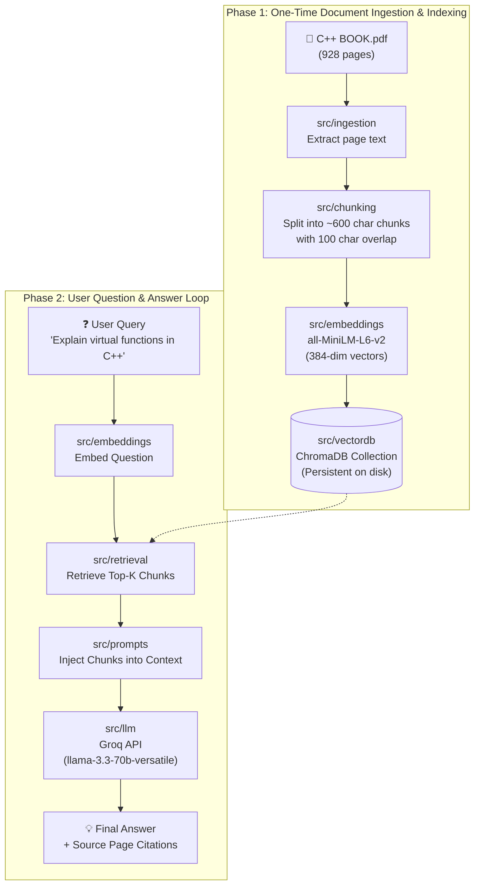

# 📚 C++ Book RAG (Retrieval-Augmented Generation)

A clean, beginner-friendly, and modular **RAG (Retrieval-Augmented Generation)** project built from scratch using Python, ChromaDB, Sentence-Transformers, and the Groq API.

The knowledge base is the provided textbook: **"Object Oriented Programming With C++"** by *E. Balagurusamy* (`C++ BOOK.pdf`).

---

## 🎯 Project Goal & Philosophy

The primary objective of this project is **clarity and reproducibility**:
1. **No bloated "black-box" frameworks**: Instead of hiding mechanics behind 50 layers of abstractions, each stage of RAG is implemented in its own clean, transparent module.
2. **Learn once, build forever**: By reading this codebase, you will understand the exact anatomy of RAG so you can confidently replicate it for any document, PDF, or dataset in future projects.
3. **Blazing fast answers**: Powered by **Groq Cloud's LPU inference** (`llama-3.3-70b-versatile` or `llama-3.1-8b-instant`).
4. **Persistent Vector Storage**: The 900+ page book is embedded and indexed into **ChromaDB** once, so subsequent runs start instantly without re-processing.

---

## 🧠 What is RAG? (In Simple Terms)

Large Language Models (LLMs) know general programming concepts, but they don't have direct access to your specific PDF files or proprietary books. 

**RAG solves this in 3 steps:**
1. **Retrieve**: When you ask a question, we search our pre-indexed vector database for the top most relevant passages from `C++ BOOK.pdf`.
2. **Augment**: We take those passages (the context) and inject them into a structured prompt alongside your question.
3. **Generate**: We send the augmented prompt to the Groq LLM, which generates an accurate answer grounded strictly in the book's contents, complete with source page references.

```
[ User Question ]
       │
       ▼
[ Convert Query to Vector ]
       │
       ▼
[ Search ChromaDB ] ─────────► [ Top Relevant Chunks from C++ Book ]
                                              │
                                              ▼
                                 [ Assemble Augmented Prompt ]
                                 (Context + User Question)
                                              │
                                              ▼
                                       [ Groq API (LLM) ]
                                              │
                                              ▼
                                    [ Grounded Answer + Pages ]
```

---

## 🏗️ Architecture & Pipeline



---

## 📂 Project Structure Breakdown

The codebase maps 1:1 to the folder structure you created:

```text
C++_Rag/
│
├── C++ BOOK.pdf                # Source dataset (E. Balagurusamy's C++ textbook)
├── config.yaml                 # Centralized configuration (model names, chunk sizes, top-k)
├── requirements.txt            # Python dependencies
├── .env.example                # Template for environment variables (GROQ_API_KEY)
├── .gitignore                  # Git ignore rules (ignores vector db, keys, cache)
├── main.py                     # Main CLI entrypoint (Indexing mode & Interactive Q&A mode)
│
├── src/                        # Modular source code
│   ├── ingestion/              # Step 1: PDF Reader
│   │   ├── __init__.py
│   │   └── pdf_loader.py       # Reads pages & extracts text + page metadata
│   │
│   ├── chunking/               # Step 2: Text Chunking
│   │   ├── __init__.py
│   │   └── text_splitter.py    # Splits text into overlapping semantic chunks
│   │
│   ├── embeddings/             # Step 3: Vector Embeddings
│   │   ├── __init__.py
│   │   └── embedder.py         # Uses sentence-transformers (local, free, fast)
│   │
│   ├── vectordb/               # Step 4: Storage
│   │   ├── __init__.py
│   │   └── chroma_store.py     # Saves and manages the local ChromaDB vector store
│   │
│   ├── retrieval/              # Step 5: Search & Retrieval
│   │   ├── __init__.py
│   │   └── retriever.py        # Performs similarity search for user queries
│   │
│   ├── prompts/                # Step 6: Prompt Engineering
│   │   ├── __init__.py
│   │   └── rag_prompt.py       # Builds clean, grounded prompts with context & citations
│   │
│   ├── llm/                    # Step 7: Generation
│   │   ├── __init__.py
│   │   └── groq_client.py      # Calls Groq API with stream / non-stream options
│   │
│   ├── utils/                  # Utilities
│   │   ├── __init__.py
│   │   ├── config_loader.py    # Reads config.yaml safely
│   │   └── logger.py           # Clean console logging
│   │
│   └── api/                    # Optional API Extension
│       ├── __init__.py
│       └── app.py              # Simple FastAPI server if you want a REST API later
│
└── data/                       # Created automatically during run
    └── chroma_db/              # Persistent vector database storage on disk
```

---

## 📋 Implementation Steps (What We Are About To Do)

### Step 1: Configuration & Environment Setup
- Create `requirements.txt` with minimal, stable libraries:
  - `groq`: Fast LLM inference client
  - `sentence-transformers`: Fast local embeddings (`all-MiniLM-L6-v2`, runs on CPU without API limits)
  - `chromadb`: Lightweight, persistent local vector database
  - `pymupdf` (fitz): Ultra-fast PDF text extraction
  - `python-dotenv`: Environment variable management (`GROQ_API_KEY`)
  - `pyyaml`: Clean configuration management
- Configure `config.yaml` for customizable hyperparameters (chunk size, overlap, embedding model, LLM model, top-k).

### Step 2: Document Ingestion (`src/ingestion/pdf_loader.py`)
- Extract clean text from `C++ BOOK.pdf` page by page.
- Attach metadata to every page (`page_number`, `source_file`) so every answer can cite the exact page number from Balagurusamy's book.

### Step 3: Text Splitting / Chunking (`src/chunking/text_splitter.py`)
- Why chunk? An LLM prompt cannot hold 900 pages at once, and smaller chunks produce much more precise semantic vector matches.
- Break text into chunks (e.g., 600 characters with 100 character overlap) to preserve context across boundaries.

### Step 4: Local Embeddings (`src/embeddings/embedder.py`)
- Use `all-MiniLM-L6-v2` via `sentence-transformers`.
- Converts text into 384-dimensional floating-point vectors.
- Completely free, runs locally on your machine, zero cost and zero rate limits.

### Step 5: Persistent Vector Store (`src/vectordb/chroma_store.py`)
- Create a persistent ChromaDB database on disk (`data/chroma_db`).
- Store document chunks, embeddings, and metadata.
- If the database already exists, skip indexing so you don't wait on future runs.

### Step 6: Similarity Search & Retrieval (`src/retrieval/retriever.py`)
- Take the user's question, embed it, and query ChromaDB for top `k` (e.g., 3-5) closest chunks using cosine similarity.
- Filter out low-relevance matches.

### Step 7: Prompt Construction (`src/prompts/rag_prompt.py`)
- Formulate a strict system prompt:
  - Instruct the model to act as an expert C++ tutor.
  - Rely exclusively on the provided book context.
  - Cite the page numbers provided in the metadata.
  - Politely state if the topic is not covered in the book instead of hallucinating.

### Step 8: Groq LLM Client (`src/llm/groq_client.py`)
- Connect to Groq using the official Python SDK.
- Use `llama-3.3-70b-versatile` (or `llama-3.1-8b-instant`) with customizable temperature.
- Support streaming responses so tokens render in real time.

### Step 9: Interactive CLI Entrypoint (`main.py`)
- Provides a clean, interactive terminal interface:
  - Check if the book has been indexed. If not, trigger indexing with a clear progress bar.
  - Start an interactive chat loop where you can ask any C++ question.
  - Display the answer along with book page citations.

---

## 🚀 How to Run (Once Implemented)

### 1. Prerequisites & API Key
Get a free Groq API key from [https://console.groq.com/keys](https://console.groq.com/keys).

Create a `.env` file in the root directory:
```env
GROQ_API_KEY=gsk_your_groq_api_key_here
```

### 2. Install Dependencies
```bash
pip install -r requirements.txt
```

### 3. Run the Application
```bash
python main.py
```
- On the first run, it will index `C++ BOOK.pdf` into `./data/chroma_db/`.
- On subsequent runs, it detects the existing database and instantly opens the Q&A loop!

---

## 💡 How You Can Reuse This for Future RAG Projects

Because of this modular design, when you want to build your next RAG project (e.g., for Python, medical docs, legal contracts, or company wikis), you only need to change:
1. Replace `C++ BOOK.pdf` with your new document.
2. In `config.yaml`, change the file path and collection name.
3. Everything else (`chunking`, `embeddings`, `vectordb`, `retrieval`, `llm`) stays 100% identical!

